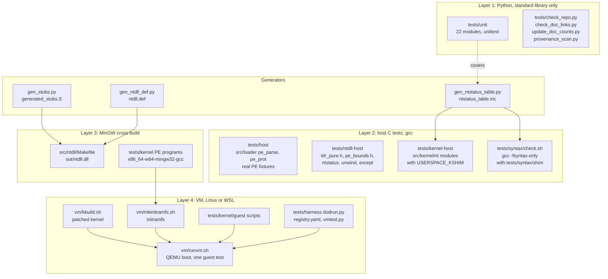

# Build and test layers

The repository has several test layers. They differ in what they compile and
what they need to run. CI runs only some of them. This page shows how the
layers relate and which ones CI covers. The commands are in
[DEVELOPMENT.md](../DEVELOPMENT.md).

## Layers

## What each layer covers

| Layer | Path | Compiles | Needs | In CI |
|---|---|---|---|---|
| 1 | `tests/unit` | the scripts in `build/`, `tools/` and `gen_ntstatus_table.py` | Python 3 | yes |
| 1 | `tools/check_repo.py`, `check_doc_links.py`, `update_doc_counts.py --check`, `provenance_scan.py --check` | nothing (reads the tree) | Python 3 | yes |
| 2 | `tests/host` | `src/loader/pe_parse.c`, `pe_prot.c` and fixtures | gcc | yes (`make -C tests/host test`) |
| 2 | `tests/ntdll-host` | pure ntdll helpers: `ldr_pure.h`, `pe_bounds.h`, `ntstatus_to_dos.c`, unwind and except tests | gcc | no |
| 2 | `tests/kernel-host` | `src/kernel/nt/*.c` against the userspace shim (`shim/`, pthreads) | gcc (UCRT on Windows) | no |
| 2 | `tests/syntax` | `src/kernel/nt`, `src/loader`, `src/kernel/fs` and `arch/x86/nt` with `-fsyntax-only` | gcc | no |
| 3 | `src/ntdll/Makefile` | `ntdll_main.c`, `ldr.c`, `except.c`, `unwind.c`, `ntdll_runtime.c` and generated stubs | MinGW gcc and Python 3 | no |
| 3 | `tests/kernel` | PE test programs for the guest | MinGW gcc | no |
| 4 | `vm/` | kernel build, initramfs, QEMU boot | WSL or Linux, a kernel tree | no |
| 4 | `tests/harness` | criteria runner, which calls `vmtest.py` and then `vm/runvm.sh` | Python 3, WSL, VM | no |

Notes on the table:

- `tests/kernel-host` compiles the kernel module sources as they are, with
  `-DUSERSPACE_KSHIM` selecting the userspace shim. Each test program links the module objects it needs, listed in
  its `*_OBJS` variables. `tests/kernel-host/README.md` has a line starting
  with `known-fail:` for modules that are expected to fail.
- `tests/ntdll-host` is not in CI and not in `tools/run_all_checks.sh`. It
  must be run by hand with `make -C tests/ntdll-host test`.
- `tests/syntax` compiles the kernel sources, which the kernel-host build
  cannot reach, against headers in `tests/syntax/shim/`. It links nothing. It
  is also not in CI.
- `src/ntdll/Makefile` is the only recipe that links `ntdll.dll`. Its
  `check` target runs `tests/ntdll-host/check_exports.sh`, which compares the
  exports with the `.def`. It uses `objdump` and never loads the DLL.
- `vm/kbuild.sh` reads `vm/kernel-config-ntpers` to build the kernel. That file
  is not in the repository.
- `vm/freshness.sh` checks the built image against a digest of its sources.
  Its header says it refuses to run the VM when the image is stale.
- `build/generated_stubs.S` is checked in. Running `build/gen_stubs.py` on
  `syscall_table.def` reproduces it exactly at this commit. No make rule
  regenerates it.

## Entry points

- `tools/run_all_checks.sh` runs the CI checks, then the local suites:
  `tests/syntax/check.sh`, `make -C tests/host test` and
  `make -C tests/kernel-host check`. It prints a PASS, FAIL, KNOWN-FAIL or SKIP
  row for each. A missing tool is a SKIP, not a failure.
- `build/Makefile` has `test` (runs `tests/harness/selftest.py`),
  `conformance`, `validate-criteria` and `ntstatus-table`. The last one
  regenerates `src/kernel/nt/ntstatus_table.inc` from `ntstatus_to_dos.c`.
- `.github/workflows/ci.yml` runs the unit tests, the host test, `vm/lint.sh`,
  `check_repo.py`, the doc-count check, `provenance_scan.py --check` and
  `check_doc_links.py`.

## Expected results

Nothing in this repository records a passing VM run or a full conformance
run. The conformance criteria are all `unknown` in
[CRITERIA.md](../status/CRITERIA.md). The doc-count check in CI compares
counts in README.md against the tree, so a stale count fails CI. The
[test matrix](../status/TEST-MATRIX.md) holds the last recorded local run.
