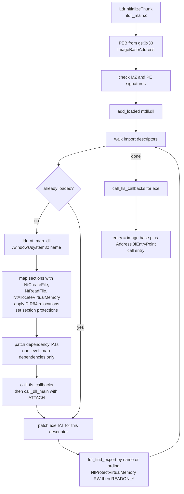
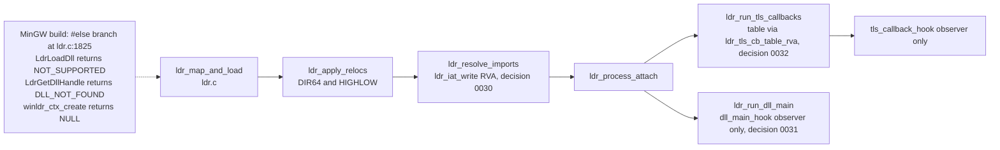

# Userspace loading

Two loaders exist in `src/ntdll`, and they are not the same code.

- **Startup loader**, `LdrInitializeThunk` in `src/ntdll/ntdll_main.c`. This is
  the one the kernel jumps to, and the one that runs in the MinGW ntdll build.
  It maps DLLs, patches import tables, runs TLS callbacks and `DllMain`, then
  calls the exe entry point.
- **Library loader**, `src/ntdll/ldr.c`, with the pure address helpers in
  `ldr_pure.h`. It has the full `Ldr*` API (`LdrLoadDll`, forwarders,
  delay imports, API sets). It is tested on the host. In the MinGW build its
  real code is excluded, and the exported `Ldr*` functions are stubs
  (decision 0029).

The status of each piece is in the table at the end.

## Startup loader flow

Step detail, all in `ntdll_main.c`:

1. The thunk reads the PEB from `gs:0x30`, then `ImageBaseAddress`. The kernel
   passes the image base in `rcx` too, but this code does not use it.
2. It maps each imported DLL from `/windows/system32/` only (MAIN-5). Mapping uses `NtCreateFile`, `NtReadFile`
   and `NtAllocateVirtualMemory`. It applies only `IMAGE_REL_BASED_DIR64`
   relocations, and it rejects other types (`MAIN-2` bounds checks).
3. The new DLL's own imports are patched. A dependency of that DLL is mapped
   if needed, but its own imports are not patched. Its `DllMain` does not run.
4. For a newly mapped top-level DLL, `call_tls_callbacks` runs first, then
   `call_dll_main` with `DLL_PROCESS_ATTACH`. The return value is ignored. There
   is no detach call and no failure path.
5. The exe import table is patched with `ldr_find_export` (by name, or by
   ordinal when the thunk has the high bit set). The IAT pages are made
   writable with `NtProtectVirtualMemory`, then set back to `READONLY`
   whatever they were before. A missing export leaves its slot unchanged and
   the load continues (`MAIN-6`).
6. The IAT slots are written at `base + thunk_rva`, which is an RVA. So the
   file-offset bug in decision 0030 does not apply to this path.
7. The exe TLS callbacks run, then the entry point is called. If it returns,
   the process terminates with status 0.

TLS callbacks are read by `call_tls_callbacks`. An `AddressOfCallBacks` value
inside the image is used as a pointer. Any other value is treated as an RVA by
subtracting the header's image base. This is a heuristic. It is not the bounded
RVA read in decision 0032, which is in the `ldr.c` branch.

## Library loader

The real code in `ldr.c` sits between `#ifndef __MINGW32__` (line 83) and the
`#else` at line 1825. Its fixes for decisions 0030 and 0032 are therefore only
in the host build. The `ntdll.dll` link in `src/ntdll/Makefile` also compiles
`ldr.c`, which in the MinGW build reduces to that stub branch.

Within the real code:

- `ldr_process_attach` runs TLS callbacks and then `DllMain`. Both only call
  observer hooks. The entry point is computed and never called (decision 0031,
  proposed). The hook type returns `void`, so a failing attach cannot be
  reported.
- `ldr_resolve_delay_imports` is real in the host build. The MinGW branch stubs it.
- API sets are read by `winldr_load_apiset_schema` and resolved by
  `winldr_apiset_resolve`. The startup loader does not call either of them.

## Status

| Piece | Startup loader (`ntdll_main.c`, linked) | Library loader (`ldr.c`, host build) |
|---|---|---|
| Import by name and ordinal | implemented. Missing export leaves the slot unchanged (MAIN-6) | implemented (`ldr_resolve_imports`). IAT write is RVA-based (decision 0030, implemented) |
| Forwarders | `ldr_resolve_forwarder`, with a depth cap | implemented in the resolver |
| Base relocations | DIR64 only. Other types are rejected (`MAIN-2`) | DIR64 and HIGHLOW, bounded (`LDR-5`) |
| TLS callbacks | run before `DllMain`. Table read by heuristic | table read by RVA and bounded (decision 0032, implemented). Observer hook only |
| `DllMain` | `DLL_PROCESS_ATTACH` for each new top-level DLL. No detach, no failure path. Not run for dependencies | observer hook only. Real call proposed (decision 0031) |
| Delay imports | not handled | real in host build. stub in MinGW build (`ldr.c` #else branch) |
| `LdrLoadDll`, `LdrGetDllHandle` | not in this path | stubs in the MinGW build (decision 0029, proposed) |
| API sets | not handled | schema loader and resolver, host build only |
| APC dispatcher | `KiUserApcDispatcher` is empty (`ntdll_main.c`) | not applicable |
| Exception dispatch | `KiUserExceptionDispatcher` calls `RtlDispatchException` (`except.c`). Unwinding is partial (`UNW-2`) | not applicable |

The review reports for these areas are [loader.md](../review/loader.md) and
[ntdll.md](../review/ntdll.md). The decisions are
[0029](../decisions/0029-loader-mingw-build-selection.md),
[0030](../decisions/0030-loader-iat-rva-patch.md),
[0031](../decisions/0031-loader-dllmain-tls-order.md) and
[0032](../decisions/0032-loader-tls-callback-table-rva.md).
