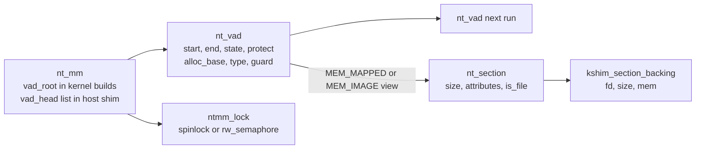
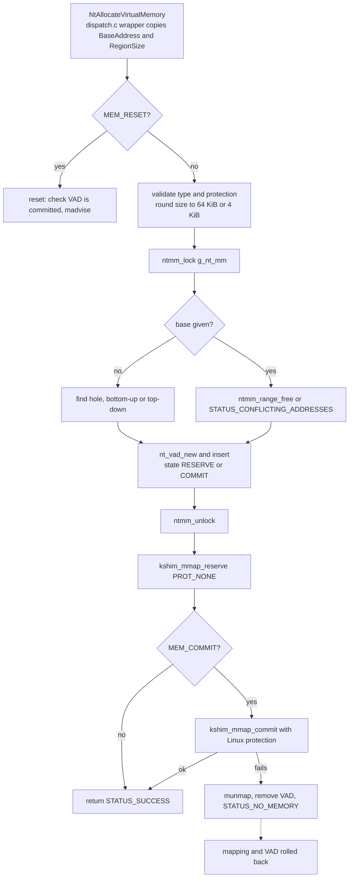
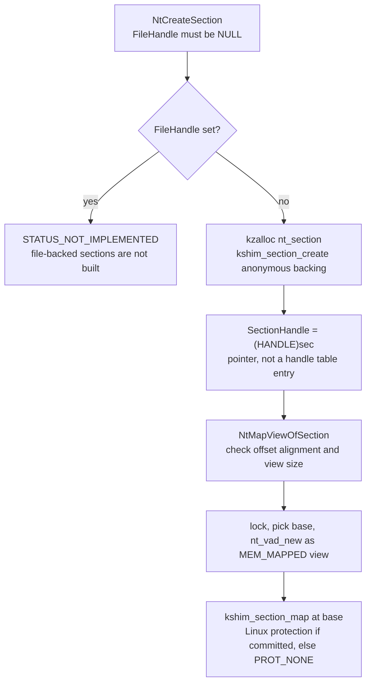

# Virtual memory

The NT memory manager is in `src/kernel/nt/mm.c`, with its types in
`mm.h`. It keeps a VAD (virtual address descriptor) list for each address
space, and maps the real pages with Linux calls. This page covers the VAD
structures, section objects and the flows for `NtAllocateVirtualMemory`,
`NtFreeVirtualMemory`, `NtProtectVirtualMemory`, `NtCreateSection` and
`NtMapViewOfSection`.

## VAD structures

- A VAD covers a run of pages with one state (`MEM_RESERVE` or `MEM_COMMIT`),
  one protection and one `alloc_base`. The kernel build keeps them in an
  rb-tree (`vad_root`). The host shim keeps a sorted list (`vad_head`).
- Adjacent VADs with equal attributes are merged by `nt_vad_coalesce` and
  `nt_coalesce_all`. `nt_vad_split` cuts a run at a page boundary.
- Granularity is 64 KiB for a reservation (`NTMM_ALLOC_GRANULARITY`) and 4 KiB
  for a page-level operation (`NTMM_PAGE_SIZE`).
- The one address space is a global `g_nt_mm`. See the gaps below.

## NtAllocateVirtualMemory

The reserve path inserts the VAD before the Linux mapping is created. If the
mapping fails, the VAD is removed again. A commit at a specific base is
different. If the range is already committed it calls `kshim_mprotect`.
Otherwise it splits the reserved runs and commits only the pieces that are
reserved. A free gap inside the range is `STATUS_INVALID_PARAMETER`.

When `PAGE_GUARD` is requested, the code sets the one global `kshim_guard`
record. It does not set a flag on the VAD.

## NtFreeVirtualMemory and NtProtectVirtualMemory

- `MEM_RELEASE` needs `RegionSize` of zero and a base that equals the VAD's
  `alloc_base`. It removes the VADs, then `kshim_munmap`s the whole range.
- `MEM_DECOMMIT` splits the VADs at the range edges, changes the state to
  `MEM_RESERVE`, and sets the range to `PROT_NONE` with `kshim_mmap_commit`.
- `NtProtectVirtualMemory` requires every page to be committed
  (`STATUS_NOT_COMMITTED` otherwise). It splits each run, sets `guard` on the
  pieces when `PAGE_GUARD` is in the new protection, then calls
  `kshim_mprotect`. It returns the old protection of the first page.

## Sections

- `NtCreateSection` returns the raw `nt_section` pointer as the section
  handle. Section handles are not in the handle table, so `NtClose` and
  `ObReferenceObjectByHandle` do not apply to them.
- File-backed sections return `STATUS_NOT_IMPLEMENTED`. A comment in the code
  says a lookup of the file handle is missing, so the section would be zeroed
  memory, not the file.
- `NtMapViewOfSection` checks the offset alignment (64 KiB for `SEC_IMAGE`, 4 KiB
  otherwise), then records a view VAD under the lock before it calls
  `kshim_section_map`. The mapping itself is done outside the lock.
- `NtUnmapViewOfSection` takes the base, which must be the VAD's `alloc_base`,
  removes the view VAD and unmaps the range.

## Loader mappings

`binfmt_pe.c` records each of its own mappings (the exe sections, the ntdll
sections, the stack, and the process parameters, PEB and TEB pages) with
`ntmm_add_region`. That
function inserts a committed VAD and coalesces it. So the VAD list shows
what the loader mapped, as well as what the NT calls mapped. See
[overview](overview.md) for the startup order.

## Gaps

- **One address space.** `NtAllocateVirtualMemory`, `NtMapViewOfSection` and
  the other calls ignore `ProcessHandle` and use `g_nt_mm`. Every process
  shares the same VAD list.
- **Guard pages are not enforced.** `NtMmHandleGuardFault` has no caller in
  `src` or `arch` (only `mm_test.c` calls it). `kshim_install_guard_handler`
  is a no-op in `kshim.c`.
- **Two copies.** `arch/x86/nt/mm.c` and `src/kernel/nt/mm.c` differ in this
  tree. See [tree-divergence.md](../analysis/tree-divergence.md).
- **Write watch** is recorded in the VAD, not enforced (`mm.h` comment).
