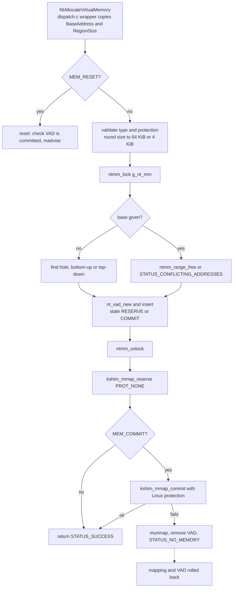
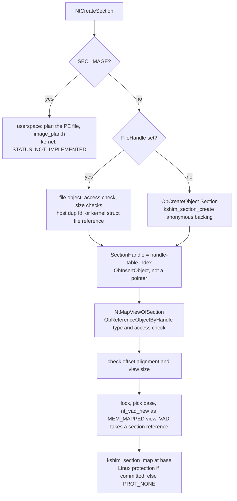

# Virtual memory

The NT memory manager is in `src/kernel/nt/mm.c`, with its types in
`mm.h`. It keeps a VAD (virtual address descriptor) list for each address
space, and maps the real pages with Linux calls. This page covers the VAD
structures, section objects and the flows for `NtAllocateVirtualMemory`,
`NtFreeVirtualMemory`, `NtProtectVirtualMemory`, `NtCreateSection` and
`NtMapViewOfSection`.

## VAD structures

- A VAD covers a run of pages with one state (`MEM_RESERVE` or `MEM_COMMIT`),
  one protection and one `alloc_base`. The kernel build keeps them in an
  rb-tree (`vad_root`). The host shim keeps a sorted list (`vad_head`).
- Adjacent VADs with equal attributes are merged by `nt_vad_coalesce` and
  `nt_coalesce_all`, but a commit does not merge them (`mm.c:1116-1118`), and
  `NtProtectVirtualMemory` does. `nt_vad_split` cuts a run at a page boundary.
- Granularity is 64 KiB for a reservation (`NTMM_ALLOC_GRANULARITY`) and 4 KiB
  for a page-level operation (`NTMM_PAGE_SIZE`).
- The one address space is a global `g_nt_mm`. See the gaps below.

## NtAllocateVirtualMemory

The reserve path inserts the VAD before the Linux mapping is created. If the
mapping fails, the VAD is removed again. A commit at a specific base is
different. If the range is already committed it calls `kshim_mprotect`.
Otherwise it splits the reserved runs and commits only the pieces that are
reserved. A free gap inside the range is `STATUS_INVALID_PARAMETER`.

When `PAGE_GUARD` is requested, the code sets the one global `kshim_guard`
record. It does not set a flag on the VAD.

## NtFreeVirtualMemory and NtProtectVirtualMemory

- `MEM_RELEASE` needs `RegionSize` of zero and a base that equals the VAD's
  `alloc_base`. It removes the VADs, then `kshim_munmap`s the whole range.
- `MEM_DECOMMIT` splits the VADs at the range edges, changes the state to
  `MEM_RESERVE`, and sets the range to `PROT_NONE` with `kshim_mmap_commit`.
- `NtProtectVirtualMemory` requires every page to be committed
  (`STATUS_NOT_COMMITTED` otherwise). It splits each run, sets `guard` on the
  pieces when `PAGE_GUARD` is in the new protection, then calls
  `kshim_mprotect`. It returns the old protection of the first page.

## Sections

- `NtCreateSection` creates a Section object (`nt_section_type`) and returns
  a handle-table index, so `NtClose` and `ObReferenceObjectByHandle` apply to
  it. `NtMapViewOfSection` needs `SECTION_MAP_READ`, plus `SECTION_MAP_WRITE`
  for `PAGE_READWRITE` and `SECTION_MAP_EXECUTE` for the execute protections.
- The section lives while it has a handle or a view. Each VAD that maps a view
  holds one object reference, dropped by `nt_vad_free`.
- File-backed data sections (`SEC_COMMIT` with a `FileHandle`) are built. The
  handle must be an open file object with `FILE_WRITE_DATA` (for a shared
  read-write section) or `FILE_READ_DATA`. The default size is the file size.
  An empty file is `STATUS_MAPPED_FILE_SIZE_ZERO`. A read-only or copy-on-write
  section larger than its file is `STATUS_SECTION_TOO_BIG`. A read-write one
  extends the file. `NtQuerySection` reports `SEC_FILE`.
- The section takes its own reference to the file data, so the file handle can
  close while views exist. In the kernel build that is a `struct file`
  reference (`get_file`, dropped in `nt_section_delete`), and views are made with
  `vm_mmap`, so shared views share the page cache. On the host the section dups
  the fd. The Windows mmap shim cannot map a file, so each host view is a copy
  filled at map time (`kshim_section_map_file`).
- On the host a shared writable view is written back to its file on
  `NtFlushVirtualMemory` and on `NtUnmapViewOfSection`. Copy-on-write and
  read-only views are not written back. Two views of one section are not
  coherent on the host until a flush, the same as anonymous sections there.
- `NtMapViewOfSection` checks the offset alignment (64 KiB for file sections and
  `SEC_IMAGE`, 4 KiB for anonymous ones), then records a view VAD under the lock
  before it calls `kshim_section_map` or `kshim_section_map_file`. The mapping
  itself is done outside the lock. A shared writable view needs a writable
  section (`STATUS_SECTION_PROTECTION`). Image sections (`SEC_IMAGE`) are
  built in the userspace build only: the file is planned by `image_plan.h`
  and mapped whole, with one `MEM_IMAGE` VAD per segment (see
  [mm.md](../modules/mm.md)). The kernel build refuses `SEC_IMAGE`.
- `NtUnmapViewOfSection` takes the base, which must be the VAD's `alloc_base`,
  removes the view VAD and unmaps the range.

## Loader mappings

`binfmt_pe.c` records each of its own mappings (the exe sections, the ntdll
sections, the stack, and the process parameters, PEB and TEB pages) with
`ntmm_add_region`. That
function inserts a committed VAD and coalesces it. So the VAD list shows
what the loader mapped, as well as what the NT calls mapped. See
[overview](overview.md) for the startup order.

## Other services

- `NtQueryVirtualMemory` also answers `MemoryRegionInformation` (class 3): the
  VAD's allocation base and protect, a `MEM_REGION_*` type bit, region size and
  commit size. Working-set and mapped-file-name classes return
  `STATUS_NOT_SUPPORTED`, since the manager keeps no residency or file names.
- `NtReadVirtualMemory` and `NtWriteVirtualMemory` copy within the caller's own
  address space, a page at a time, and stop at the first byte that is not
  committed or has the wrong protection (`STATUS_PARTIAL_COPY`, with the count
  moved so far). Writes to `PAGE_READONLY` fail. A `ProcessHandle` other than
  `NtCurrentProcess` gives `STATUS_NOT_SUPPORTED`.
- `NtFlushVirtualMemory` checks that the page-rounded range is committed and
  reports it flushed. Nothing is written back: there is no file backing yet. Only
  the current-process handle is accepted (`mm.c:1605`).
- `NtAllocateVirtualMemoryEx` is `NtAllocateVirtualMemory` when no extended
  parameters are given. Any extended parameter returns `STATUS_NOT_SUPPORTED`.
- Not implemented: `NtLockVirtualMemory` and `NtUnlockVirtualMemory` (need a
  page-lock primitive in kshim). `NtQuerySection`, `NtExtendSection`,
  `NtOpenSection`, `NtCreateSectionEx`, `NtMapViewOfSectionEx` and
  `NtUnmapViewOfSectionEx` have no service entry. `NtCreateSection`,
  `NtMapViewOfSection` and `NtUnmapViewOfSection` exist as C functions in
  `mm.c` but have no `nt_svc_` wrapper, so their dispatch slots are NULL. The
  section handle is a handle-table index (ADR 0001, record 0001), so adding those
  wrappers is now a matter of wiring the table entry, not of changing the handle.

## Gaps

- **One address space.** `NtAllocateVirtualMemory`, `NtMapViewOfSection` and
  the other calls ignore `ProcessHandle` and use `g_nt_mm`. Every process
  shares the same VAD list.
- **Guard pages are not enforced.** `NtMmHandleGuardFault` has no caller in
  `src` or `arch` (only `mm_test.c` calls it). `kshim_install_guard_handler`
  is a no-op in `kshim.c`.
- **Two copies.** `arch/x86/nt/mm.c` and `src/kernel/nt/mm.c` differ in this
  tree. See [tree-divergence.md](../analysis/tree-divergence.md).
- **Write watch** is recorded in the VAD, not enforced (`mm.h` comment).
