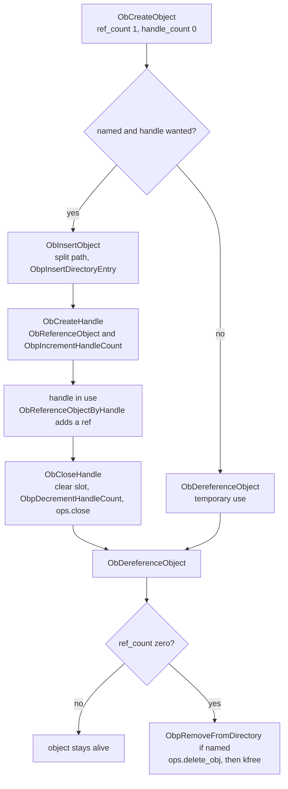
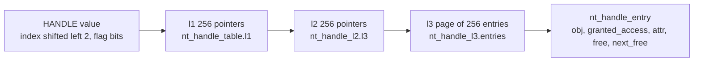
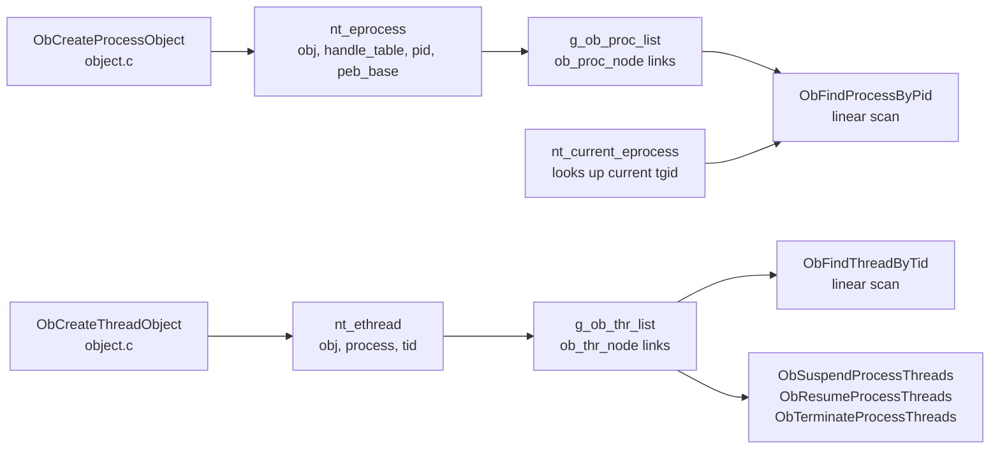

# Object model

The object manager in `src/kernel/nt/object.c` and the handle table in
`src/kernel/nt/handle.c` give NT-style objects, typed handles and reference
counts. This page covers the lifecycle, the handle table layout and the
process and thread registry. The header declarations are in `object.h` and
`handle.h`.

## Lifecycle

An object has two counts: `ref_count` (kernel references) and `handle_count`
(open handles). The header and body are one allocation, made in
`ObCreateObject`. The object is freed only when `ref_count` reaches zero.

Notes on the code:

- `ObInsertObject` takes a name that must be absolute (it starts with a
  backslash). It splits the name into a parent directory and a leaf, then
  inserts the leaf. If the handle step then fails, the directory entry is
  removed again.
- `ObDereferenceObject` asserts that `handle_count` is zero when the last
  reference goes. The root directory header is static and is never freed.
- `ObCloseHandle` runs the type's `okay_to_close` hook under the table spinlock.
  Its contract forbids blocking and handle-table calls. It then clears the slot,
  drops the handle count, runs `ops.close`, and drops one reference.
- Object types are listed in `ob_type_list`: directory, symbolic link, process,
  thread and a test type. `ObCreateObjectType` is declared in `object.h` but has
  no definition, so only `ObRegisterObjectType` is usable.
- `ObInitObjectManager` creates the well-known directories `??`, `Device`,
  `BaseNamedObjects`, `KnownDlls` and `Sessions` under the root.

## Handle table layout

A handle value is `index << 2` with the low two bits used for flags.
`HANDLE_FLAG_PROTECT_FROM_CLOSE` is bit 0 and `HANDLE_FLAG_INHERIT` is bit 1.
Index 0 is never used, so `NULL` is not a valid handle.

- Capacity is 2^24 indices (`HANDLE_INDEX_BITS` is 24). Pages are allocated
  when first used by `ht_entry`.
- `ht_alloc_index` takes a slot from `high_water`. It reuses a closed slot only
  when more than `HANDLE_QUARANTINE` (4096) slots are free. Reuse is FIFO, with
  `first_free` and `last_free`.
- `ObReferenceObjectByHandle` checks the type, then that
  `desired_access` is inside `granted_access`. It returns
  `STATUS_ACCESS_DENIED` otherwise. It does not call the security code.
- Pseudo handles (`NtCurrentProcess`, `NtCurrentThread`) are resolved in
  `ObReferenceObjectByHandle` and are never stored in the table. `ObCloseHandle`
  rejects them.

The comments in `handle.c` describe a LIFO free list and a close-pending state
for file objects. The code has neither. It uses the FIFO and quarantine
described above, and no close-pending state exists.

## Process and thread registry

Processes and threads are objects like any other, and each has a registry node
so it can be found by PID or TID.

- `ObCreateProcessObject` allocates the `nt_eprocess`, creates its handle table
  and creates the process object. `ObCreateThreadObject` does the same for
  threads. Their numbers come from a sequence (`g_proc_pid_seq`,
  `g_thread_tid_seq`) when the caller passes no ID.
- `ObRegisterThread` ignores a second registration of the same thread.
- In a kernel build, the registry lists are guarded by spinlocks. In the host
  build they use `pthread_once` and mutexes. Lookup is a linear walk in both.
- `nt_current_eprocess` (kernel build) looks the current task up by `tgid`. If
  there is no entry, it creates one, and it reads the PEB pointer from
  `mm->start_data`. This is how the first PE process gets an object, because
  `binfmt_pe` does not create one.
- `NtDuplicateObject` and `ObInheritHandles` copy handles between tables. Only
  handles marked `OBJ_INHERIT` are inherited, and they keep the same value.
- Security descriptors are stored on the header but are not checked on handle
  use. See [security](../modules/security.md).
