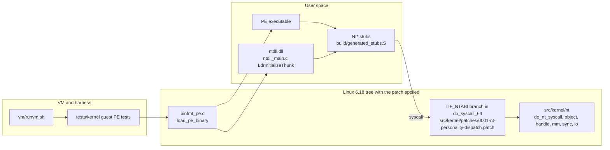
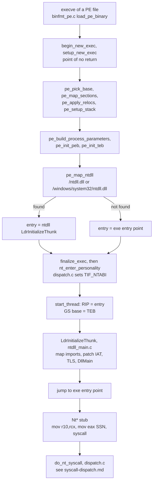

# Architecture overview

This page shows the parts of the ntpers prototype and how a PE executable
gets from `execve` to an NT system call. It describes what the code in this
repository contains. Nothing here has been built, booted or run for this page.
The component status is in [ARCHITECTURE-STATUS.md](../phase2/ARCHITECTURE-STATUS.md).

Each diagram box names the file or function it comes from, so it can be
checked with `git grep`. The deeper pages are:

- [syscall-dispatch.md](syscall-dispatch.md): from the `syscall` instruction to the handler.
- [object-model.md](object-model.md): objects, handles and the process and thread registry.
- [memory.md](memory.md): VADs, sections and the virtual memory calls.
- [loading.md](loading.md): the userspace loader in ntdll.
- [build-and-test.md](build-and-test.md): which build and test layer covers what.

## Components

| Component | Where | Role |
|---|---|---|
| Loader | `src/kernel/fs/binfmt_pe.c` (`load_pe_binary`) | Linux binary format handler. Maps the exe and ntdll, builds the stack, PEB and TEB, and starts the task. |
| Arch glue | `src/kernel/patches/0001-nt-personality-dispatch.patch` | Adds `TIF_NTABI` (bit 29) and one branch in `do_syscall_64`. The patch targets an external kernel tree, which is not in this repository. |
| NT personality | `src/kernel/nt/` | `dispatch.c` (`do_nt_syscall`), `nt_service_list.h`, `object.c`, `handle.c`, `mm.c`, `sync.c`, `io.c`, `proc_thread.c`, `registry.c`, `security.c`. |
| ntdll | `src/ntdll/ntdll_main.c`, `ldr.c`, `except.c`, `unwind.c` | Startup loader (`LdrInitializeThunk`), exception dispatch and unwinding. Syscall stubs are generated by `build/gen_stubs.py`. |
| Shared PE parser | `src/loader/pe_parse.c`, `pe_prot.c` | Hardened parser used by the host tests. The kernel loader does not use it (review finding L-0 in [loader.md](../review/loader.md)). |
| VM and harness | `vm/*.sh`, `tests/kernel/`, `tests/harness/` | Build the kernel, boot it under QEMU, and run PE tests in the guest. |

## How a PE executable starts

The kernel does most of the mapping. ntdll does the import and TLS work, then
jumps to the exe entry point.

1. `load_pe_binary` checks the headers and maps the exe. It calls
   `begin_new_exec` first, so an error after that point cannot be undone.
   Failures after that point go through `pe_post_commit_fail`.
2. `pe_map_ntdll` maps ntdll from one of two paths. If it is not found, the
   exe entry point runs without ntdll, and the task has no loader.
3. `nt_enter_personality` runs after `finalize_exec` and before `start_thread`.
   In a build with `CONFIG_NT_PERSONALITY`, it sets `TIF_NTABI` on the task and
   creates the NT thread object. Without that config, the call is a no-op.
4. From then on, every `syscall` by this task goes to `do_nt_syscall`, not the
   Linux table. The switch is per task. `MSR_LSTAR` is shared, which is why the
   branch sits in the common entry code.
5. `LdrInitializeThunk` finds the PEB through `gs:0x30`. It loads the imports
   and runs DLL initialisation. The details are in [loading.md](loading.md).

## Known gaps

- There is one global address space in `mm.c` (`g_nt_mm`). The process handle
  argument is ignored. See [memory.md](memory.md).
- Process creation: `NtCreateProcessEx`, `NtCreateProcess` and
  `NtCreateUserProcess` return `STATUS_NOT_IMPLEMENTED` in the kernel build.
  PE processes start only by `execve`. See
  [process-creation.md](process-creation.md) and the open decision
  [0037](../decisions/0037-process-creation.md).
- The kernel loader maps ntdll from paths that the review flags as unsafe
  (K-5 in [kernel-fs.md](../review/kernel-fs.md)).
- No Win32 user-mode surface beyond a minimal `kernel32` and `user32`.
  `d3d`, `dxgi` and `ntafd` are missing. See the status page.
