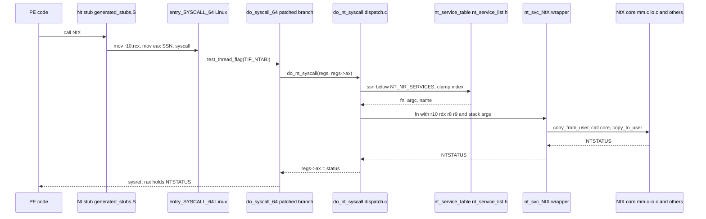

# System-call dispatch

This page follows one NT system call from the `syscall` instruction in ntdll
to the handler and back. The main files are `src/kernel/nt/dispatch.c`,
`src/kernel/nt/nt_service_list.h`, `src/ntdll/syscall_table.def` and the
generated stubs in `build/generated_stubs.S`.

## Path of one call

Step by step:

1. The stub moves `rcx` to `r10` and loads the service number into `eax`.
   It is generated from `syscall_table.def` by `build/gen_stubs.py`. The
   `src/ntdll/syscall_stub.S` file is not linked (see the MinGW Makefile).
2. The patched `do_syscall_64` tests `TIF_NTABI` before the Linux entry
   work. Linux tasks never reach this branch, and NT tasks never enter the
   Linux table.
3. `do_nt_syscall` increments the per-CPU counters, then rejects an SSN of
   `NT_NR_SERVICES` (476) or more. It clamps the index with `array_index_nospec`.
4. The table entry is built from `nt_service_list.h`. Each `NT_SERVICE(ssn,
   name, argc)` line sets `.fn`, `.argc` and `.name`. A missing service
   resolves to NULL, because each `nt_svc_` symbol is declared `weak`.
5. Arguments 1 to 4 come from `r10`, `rdx`, `r8` and `r9`. Any further
   arguments are read from the user stack at `sp + 0x28` by
   `nt_fetch_stack_args`, but only when `argc` is above 4.
6. The wrapper (for example `nt_svc_NtAllocateVirtualMemory` in `dispatch.c`)
   copies user buffers in with `copy_from_user`, calls the core, and copies
   the results out with `copy_to_user`.
7. `regs->ax` receives the status. Then `TIF_NTSUSPEND` is checked, and
   `nt_can_sysret` returns `true` in every case.

## Status return

The status is written as an unsigned 32-bit value. There is no `-errno`
conversion, on either side.

| Situation | Value in `rax` | Source |
|---|---|---|
| Handler returns a status | the NTSTATUS, zero-extended | `do_nt_syscall`, `regs->ax = (unsigned long)status` |
| SSN at or above 476 | `STATUS_INVALID_SYSTEM_SERVICE` (0xC000001B) | `do_nt_syscall` |
| Table entry is NULL | `STATUS_NOT_IMPLEMENTED` (0xC0000002) | `nt_report_missing_service`, then return |
| Stack argument fetch fails | `STATUS_ACCESS_VIOLATION` (0xC0000005) | `nt_fetch_stack_args` |
| A wrapper cannot copy a user buffer | `STATUS_ACCESS_VIOLATION` | wrapper, for example `nt_svc_NtAllocateVirtualMemory` |

The ntdll stub returns `rax` unchanged. Conversion to a DOS error is a
separate call. `RtlNtStatusToDosError` is listed as SSN 0x1db in the table,
but this is not the same as the status convention above.

## Table coverage

`nt_service_list.h` has 171 entries. `NT_NR_SERVICES` is 476, which is the
highest SSN (0x1db) plus one (`nt_internal.h:16`). Checked at this commit:

- 122 of the 171 names have a `nt_svc_` definition in `src/kernel/nt/`
  (non-test sources). `docs/status/SERVICES.md` counts 120 of them as
  IMPLEMENTED and 2 (`NtGetContextThread`, `NtSetContextThread`) as
  STUB-NOT-IMPLEMENTED.
- The other 49 names have no definition, so they return
  `STATUS_NOT_IMPLEMENTED`. The section services (`NtCreateSection`,
  `NtOpenSection`, `NtMapViewOfSection`) and the port services are among them,
  as are `NtAlertResumeThread` and `NtWaitForAlertByThreadId`. `NtAllocateVirtualMemoryEx`
  now has a definition (`dispatch.c:348`).

`tools/check_syscall_tables.py` reports parity for the 171 services across the
seven copies of the table. No generator produces `nt_service_list.h`. The
copies are kept in step by hand and checked by that tool. The comment at
`nt_internal.h:57` says the prototypes are generated from `syscall_table.def`.
No generator in `build/` or `tools/` produces them, so that comment is not
accurate.

The SSNs are described as frozen for Windows Server 2022 build 20348. This
repository does not contain a reference table from that build, so this page
does not check the numbers against it.

## Observability

The dispatch code exports per-CPU counters through debugfs under `ntpers/`:
`dispatch_count`, `host_count` and `dispatch_per_ssn` (the last lists the
non-zero SSNs by name).
